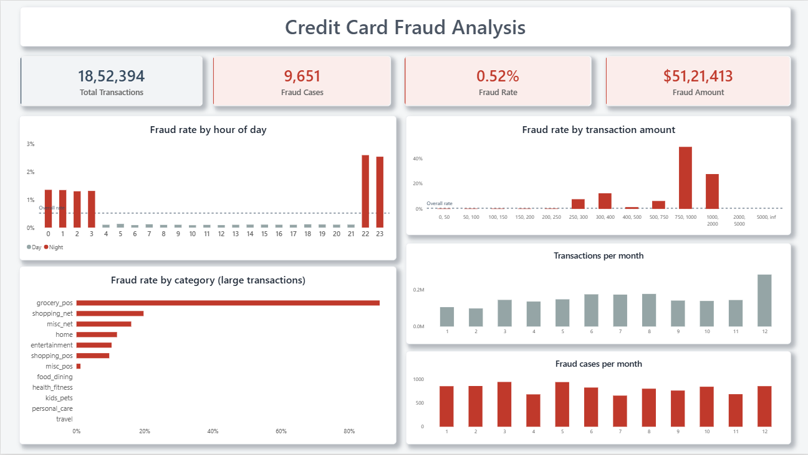
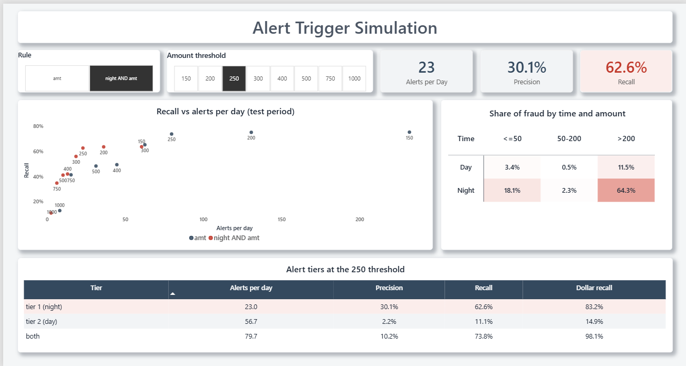

# Credit Card Fraud Detection Analysis

A bank can't look at every card transaction by hand, so it sets rules that raise an alert when something looks off. Set the rules too loose and the review team drowns in false alarms. Set them too tight and fraud slips through. This project tries to find a sensible middle.

The question I wanted to answer: **which transaction patterns signal fraud, and which triggers should a real-time alert system use?**

I analysed about 1.85 million card transactions in Python, tested a set of possible alert rules, and built a two-page Power BI dashboard to show the results.

## The data

I used the simulated credit card fraud dataset on Kaggle by kartik2112: [Credit Card Transactions Fraud Detection Dataset](https://www.kaggle.com/datasets/kartik2112/fraud-detection).

- 1,852,394 transactions from 1 Jan 2019 to 31 Dec 2020
- 999 cards, 693 merchants, 51 states (50 plus DC)
- 9,651 fraud transactions, which is 0.52%, or roughly 1 in 190
- Two files: a train file (up to 21 Jun 2020) and a test file (after that)
- No missing values, no duplicates

I started out looking at the well-known European card dataset (284,807 transactions) but dropped it. It only covers two days, has no dates, and its columns are scrambled, so I couldn't look at monthly patterns or say anything in business terms. This one has timestamps, merchant categories and locations.

It is simulated, so everything below describes this dataset. I wouldn't expect the exact thresholds to hold on real bank data. The method should.

## What I did

I loaded both files, tagged each row as train or test, and cleaned up the columns. I dropped names and street addresses because I didn't need them, and I wouldn't want them in a public dashboard anyway. Then I added a few columns: hour, month, weekday, age at the time of the transaction, amount bands, and the distance between the cardholder's home and the merchant.

For the analysis I compared fraud **rates**, not counts. Counts mostly follow how many transactions happen, so they can look like a pattern when they aren't. I also used **lift**, which is a segment's fraud rate divided by the overall 0.52%.

For the rules, I used the train period to pick thresholds and the test period to check them. A rule that only works on the data it was tuned on isn't worth much.

Accuracy is useless when 99.5% of transactions are legitimate (a rule that flags nothing is 99.5% accurate), so I judged each rule on four things:

- **Alerts per day**: how much work it creates for a reviewer
- **Precision**: how many of the alerts are real fraud
- **Recall**: how much of the fraud it catches
- **Dollar recall**: how much of the fraud money it catches

## What I found

**Time of day matters a lot.** The hours from 10 PM to 4 AM have 23.5% of transactions but 84.6% of fraud. Fraud runs at about 2.6% around 10 to 11 PM, about 1.3% from midnight to 4 AM, and about 0.1% during the day.

**Month and weekday don't mean much.** Fraud cases per month stay between about 650 and 940, while the number of transactions swings from 98,000 to 281,000. So a month looks "safer" or "riskier" mostly because of how many normal transactions it has. December is the clearest example. I didn't claim any seasonal pattern.

**Amount matters even more.** Transactions of 200 dollars or more are 4.7% of all transactions and 75.8% of fraud. Below 250 dollars fraud is close to zero, then it jumps: roughly 8% for 250 to 300 and 12% for 300 to 400, and it peaks at 49% for 750 to 1,000. Above 2,000 dollars there is no fraud at all.

**Category only really shows up on large transactions.** Across everything, shopping_net, misc_net and grocery_pos are about 2.4 to 3.1 times the average rate, which looks modest. But among transactions of 250 dollars or more, grocery_pos is about 89% fraud, shopping_net 20% and misc_net 16%, while travel, food_dining, health_fitness, kids_pets and personal_care have none. I only noticed this after checking category within the large transactions, so the first chart had hidden it.

**Things that turned out not to help:**

- Distance from home. The median is about 78 km for both fraud and normal transactions, and the two histograms sit on top of each other.
- State. Only 21 of the 51 states have 20 or more cards, and among those the fraud rate only ranges from 0.44% to 0.65%. With so few cardholders per state, I wouldn't call any state riskier.
- A few bad cards. 976 of the 999 cards have at least one fraud transaction, and the top 10% of them account for just 15% of fraud. So fraud is spread out, which is why simple rules on amount and time make sense.

**Night and amount together:**

| | 50 dollars or less | 50 to 200 dollars | Over 200 dollars |
|---|---|---|---|
| Day | 3.4% of fraud | 0.5% | 11.5% |
| Night | 18.1% | 2.3% | 64.3% |

Night transactions over 200 dollars are only 1.4% of volume but hold 64% of all fraud. No single rule gets all three of the big groups, though.

## Testing alert rules

First I tried some obvious rules at a 200 dollar threshold (test period):

| Rule | Alerts per day | Precision | Recall | Dollar recall |
|---|---|---|---|---|
| Amount 200+ | 130.7 | 6.4% | 75.1% | 98.7% |
| Amount 500+ | 31.3 | 17.0% | 48.3% | 82.8% |
| Night | 670.8 | 1.4% | 84.2% | 84.7% |
| Night AND amount 200+ | 36.3 | 19.4% | 63.5% | 83.6% |
| Night OR amount 200+ | 765.2 | 1.4% | 95.8% | 99.8% |

Night on its own and night OR amount catch a lot of fraud, but they fire 670 to 765 times a day and roughly 98 out of 100 alerts are false. Nobody could review that. Night AND amount is much more workable.

Then I tried different amount thresholds to see where to draw the line (test period):

| Threshold | Amount rule: alerts per day | Recall | Night AND amount: alerts per day | Recall |
|---|---|---|---|---|
| 150 | 231.9 | 75.2% | 60.5 | 63.6% |
| 200 | 130.7 | 75.1% | 36.3 | 63.5% |
| 250 | 79.7 | 73.8% | 23.0 | 62.6% |
| 300 | 62.6 | 65.2% | 18.6 | 55.9% |
| 500 | 31.3 | 48.3% | 10.2 | 41.1% |

I went with **250 dollars**. Going from 200 to 250 cuts alerts by about 38% and loses only about one point of recall. Going from 250 to 300 loses about nine points for not many fewer alerts. That also lines up with where the fraud rate jumps in the amount chart.

I also tried adding merchant category. Limiting the 250 dollar amount rule to the six categories that actually showed fraud at that size cut alerts from 79.7 to 52.4 a day and kept recall at 73.0% (down from 73.8%). Precision went from 10.2% to 15.4%. A narrower rule, grocery_pos with amount of 250 or more, fires about 3 times a day with 84% precision, but it only catches about 23% of fraud. I built the category list from the train period only.

One thing to be upfront about: precision is lower on the test period than on train for every rule (for example 39% down to 30% for the night tier). Recall barely changed. I report the test numbers.

## What I would recommend

At a 250 dollar threshold, on the test period:

| Tier | Alerts per day | Precision | Recall | Dollar recall |
|---|---|---|---|---|
| Tier 1: night AND amount 250+ | 23.0 | 30.1% | 62.6% | 83.2% |
| Tier 2: daytime AND amount 250+ | 56.7 | 2.2% | 11.1% | 14.9% |
| Both | 79.7 | 10.2% | 73.8% | 98.1% |

1. Make **night AND amount of 250 or more** the main trigger. About 23 alerts a day, roughly one in three is real fraud, and it catches 63% of fraud cases and 83% of the fraud money.
2. Add the **daytime** tier only if the review team has the capacity. It adds about 57 alerts a day at 2% precision, but takes dollar recall to 98%. How much capacity a real team has is something this data can't tell me, so it's an assumption.
3. **grocery_pos with amount 250 or more** could be a very high-confidence add-on.
4. I wouldn't use night alone, night OR amount, distance, state, month or weekday.

There's a gap I couldn't close. Small night transactions (50 dollars or less) make up about 18% of fraud, and no amount-based rule touches them.

## Dashboard

There are two pages, one for each half of the question.

**Fraud Patterns** shows the totals (transactions, fraud cases, fraud rate, fraud amount), then fraud rate by hour, amount and category, and transactions against fraud cases by month.



**Alert Triggers** lets you pick a rule and an amount threshold and see alerts per day, precision and recall. It also has a chart of recall against alert volume, a grid showing where the fraud sits by time and amount, and the tier table. Everything on this page uses the test period.



## Limitations

- The data is simulated. The sharp patterns, like the hour cutoffs at 10 PM and 4 AM, are probably built into the generator, so I wouldn't read them as how real fraud behaves.
- With only 999 cards, state comparisons are weak. I left out 30 states with fewer than 20 cards.
- Distance never goes above about 150 km in this data, so I couldn't test whether far-from-home purchases are suspicious.
- I assumed no cost for a missed fraud or for reviewing an alert, and no review capacity. Both would change which threshold is best.
- I tested simple rules, not a machine learning model.
- I didn't check how much the grocery_pos rule overlaps with the night tier.
- Some values are odd, like cardholders aged 13.

## Files and how to run

```
credit-card-fraud-analysis/
  README.md
  fraud_analysis.ipynb      the analysis and rule testing
  fraud_dashboard.pbix      Power BI dashboard
  powerbi_exports/          summary tables used by the dashboard
  images/                   dashboard screenshots
```

1. Download `fraudTrain.csv` and `fraudTest.csv` from the Kaggle link above and put them in the same folder as the notebook. They're too big to include in the repository.
2. Install the packages: `pip install pandas numpy matplotlib jupyter`
3. Run all cells in `fraud_analysis.ipynb`. The last cell writes the summary tables to `powerbi_exports/`.
4. Open `fraud_dashboard.pbix` in Power BI Desktop. If it asks where the data is, point it to `powerbi_exports/`.

Tools: Python (pandas, NumPy, Matplotlib), Jupyter, Power BI
